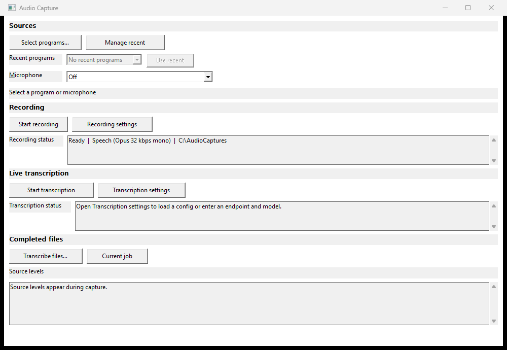
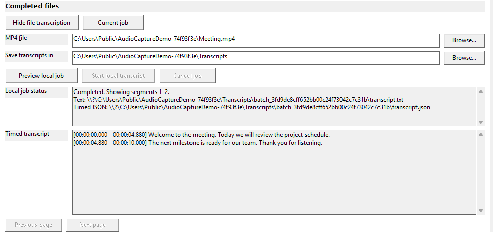
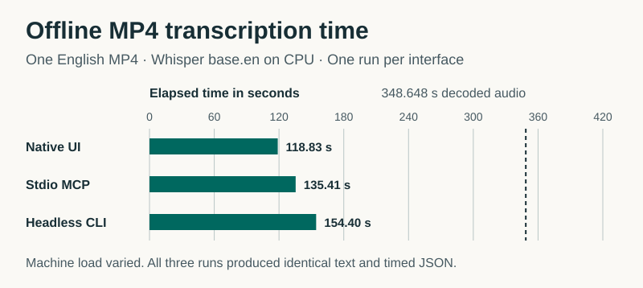

# Audio Capture


Record audio from selected Windows apps, the default playback device, or a microphone. Save a mix, separate tracks, or both. Transcribe a finished English MP4 offline on your computer.

## Download for Windows 11 x64

**[Download Audio Capture 2.2.0](https://github.com/scubamount/AudioCapture/releases/download/v2.2.0/AudioCapture-Rust-Windows-x64.zip)** · [Optional Whisper base.en model](https://github.com/scubamount/AudioCapture/releases/download/v2.2.0/AudioCapture-Whisper-base.en-model.zip) · [SHA-256 checksums](https://github.com/scubamount/AudioCapture/releases/download/v2.2.0/SHA256SUMS.txt) · [Release notes](https://github.com/scubamount/AudioCapture/releases/tag/v2.2.0)

1. Extract the app ZIP to a writable folder.
2. Keep `audio-capture.exe` and `transcribe.exe` together.
3. Run `audio-capture.exe`.

Download the model only if you want offline MP4 transcription. The app ZIP includes the operator guide, `config/transcription.example.json`, and dependency notices. [Verify the downloads](#verify-the-downloads)



## Record your sources

1. Open **Select programs…**. Choose the app you want to record.
2. Choose a device in **Microphone** to include your voice.
3. Open **Recording settings**. Select an **Output folder**.
4. Select **Start recording**. Select **Stop recording** to finalize the saved files.

For all output from the default playback device, select **Capture all system audio**. To restore a prior app selection, choose an entry under **Recent programs**. Use **Separate files** to keep app audio and microphone audio on their own tracks. [Recording guide](rust/README.md#record-a-discord-conversation)

The first-run profile is **Speech (Opus 32 kbps mono)**. Other profiles include Opus DTX, stereo Opus, and 16 kHz mono WAV. You can also select FLAC or MP3. **Skip silence** removes quiet intervals from the saved timeline. [Choose a profile](rust/README.md#choose-a-recording-profile) · [Recording settings screenshot](docs/images/recording-profiles.png)

## Transcribe an English MP4 offline

1. Extract the model ZIP to its own folder.
2. Open **Transcribe files…** in Audio Capture.
3. Set **Model pack folder** to the extracted folder.
4. Select **Import base.en pack**.
5. Select an **MP4 file**. Choose a folder under **Save transcripts in**.
6. Select **Preview local job**. Review the input and destination.
7. Select **Start local transcript**.

Each job transcribes the first audio track of one finished MP4. Audio Capture runs Whisper on the CPU without sending the file to a service. Review the result under **Timed transcript** or read the saved `transcript.txt` and `transcript.json`. [Offline setup and output files](rust/README.md#transcribe-an-mp4-offline) · [Model import screenshot](docs/images/local-mp4.png)



### Run a local job from an agent or script

The Windows UI, JSON CLI, and Model Context Protocol (MCP) server use the same local job queue. Use an operator-provisioned grant to limit an agent to selected input and output paths. Preview the job. Approve it to start work. [Grant and job examples](rust/README.md#control-a-local-mp4-job)

| Interface | Entry point |
| --- | --- |
| JSON CLI | `audio-capture.exe control` |
| stdio MCP | `audio-capture.exe mcp` |
| Existing terminal CLI | `transcribe.exe control` |

From PowerShell in the app folder, query the supported operations.

```powershell
'{"schema_version":1}' | .\audio-capture.exe control diagnostics capabilities --json --input -
```

## Transcribe through an endpoint

Use **Transcription settings** to load your config or enter a compatible endpoint and model. For speech during a call, use **Start transcription**. Recording and live transcription start and stop independently. [Live transcription guide](docs/live-transcription.md) · [Live settings screenshot](docs/images/live-transcription.png)

For completed audio or video files, open **Transcribe files…**. Select **Use an endpoint…**. Review the transfer before you approve it. For video, the worker extracts the first audio track and sends only audio. [Endpoint batch guide](rust/README.md#use-an-endpoint-for-completed-files)

Speaker attribution, name review, and memory export are separate workflows for finished transcripts. Speaker analysis can use compatible provider results or an optional local adapter. [Speaker and memory guide](docs/speaker-workflow.md)

## Measured on Windows

One 5-minute 49-second English MP4 produced identical text and timed JSON through the native UI, CLI, and MCP. Each interface processed the file once on the same Windows PC. The three runs took 119 to 154 seconds and used about 571 MiB of peak committed memory per process. [Method and results](docs/performance.md#offline-mp4-transcription)



Explore storage and recording measurements in the benchmark guide. [All benchmark figures](docs/benchmarks/README.md)

## Verify the downloads

Save `SHA256SUMS.txt` beside the ZIP files. Run these commands in PowerShell before you extract them. The check covers the Windows app ZIP and the model ZIP if present.

```powershell
$zipNames = @('AudioCapture-Rust-Windows-x64.zip')
$modelZip = 'AudioCapture-Whisper-base.en-model.zip'
if (Test-Path -LiteralPath $modelZip) { $zipNames += $modelZip }
$checksums = Get-Content -LiteralPath .\SHA256SUMS.txt

foreach ($zip in $zipNames) {
    $pattern = '^([0-9a-f]{64})\s+\*?' + [regex]::Escape($zip) + '$'
    $line = $checksums | Where-Object { $_ -match $pattern } | Select-Object -First 1
    if (!$line) { throw "Missing checksum for $zip." }

    $expected = ($line -split '\s+', 2)[0]
    $actual = (Get-FileHash -LiteralPath $zip -Algorithm SHA256).Hash
    if ($actual -ne $expected) { throw "Checksum mismatch for $zip." }
    "Verified $zip"
}
```

## Project documentation

| Task | Guide |
| --- | --- |
| Run the app, load a config, or fix a problem | [Operator guide](rust/README.md) |
| Build the portable app from source | [Build guide](BUILD.md) |
| Locate code, tests, and specifications | [Maintainer wiki](docs/wiki/README.md) |
| Track the native transcription and agent controls | [OpenSpec implementation notes](openspec/changes/integrate-native-workflows-and-agent-control/tasks.md) |
| Use the original Win32 recorder | [Legacy guide](docs/legacy/README.md) · [Legacy build](docs/legacy/BUILD.md) · [Original download](https://github.com/masonasons/AudioCapture/releases/tag/latest) |

## License

This project is provided as-is for educational and personal use.

## Credits

The original AudioCapture project is by masonasons. Its README states, “This was written with Claude Code.” [Original project](https://github.com/masonasons/AudioCapture)

The Rust app uses WASAPI for capture, Win32 for its controls, and Media Foundation for decoding video audio. Candle runs the offline model. See `licenses/DEPENDENCIES.md` in the app ZIP for dependency notices.
