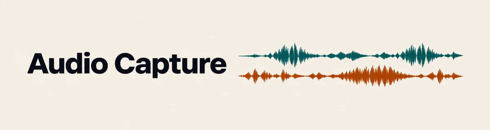

# Audio Capture



Record selected Windows applications, system audio, and one microphone on Windows 11 x64. The Rust recorder uses native Windows controls and WASAPI. Save a mix, separate tracks, or both in WAV, MP3, Opus, or FLAC.

## Download for Windows 11 x64

**[Download the latest stable ZIP](https://github.com/scubamount/AudioCapture/releases/latest/download/AudioCapture-Rust-Windows-x64.zip)** · [Latest release and checksum](https://github.com/scubamount/AudioCapture/releases/latest)

Version 2.1.0 adds independent recording, live transcription, and shared batch settings. Its ZIP includes `config/transcription.example.json`. [Version 2.1.0 release notes](https://github.com/scubamount/AudioCapture/releases/tag/v2.1.0)

To verify the download before extraction, save `SHA256SUMS.txt` from the same release as the ZIP. Run these commands in PowerShell from the download folder.

```powershell
$zip = 'AudioCapture-Rust-Windows-x64.zip'
$expected = ((Get-Content -LiteralPath .\SHA256SUMS.txt -TotalCount 1) -split '\s+', 2)[0]
$actual = (Get-FileHash -LiteralPath $zip -Algorithm SHA256).Hash
if ($actual -ne $expected) { throw 'ZIP checksum mismatch.' }
'ZIP checksum matches.'
```

Extract `AudioCapture-Rust-Windows-x64.zip`. Run `audio-capture.exe` from the extracted folder. The ZIP includes `transcribe.exe`, the operator guide as `README.md`, and dependency notices.

You can also make the portable ZIP from source. [Build guide](BUILD.md)

## Record and transcribe

1. Select one or more **Programs**, or select **Capture all system audio**. You can also choose a recent program.
2. Select a **Microphone** if you need one.
3. Choose your **Recording settings** and **Output folder** before starting either activity.
4. Select **Start recording** to save audio.
5. Select **Start transcription** to create text during the call. Review the destination and approve the selected sources.

Use **Stop recording** or **Stop transcription** to finish one output while the other continues. **Stop both** gives the active audio and transcript intervals the same cutoff. [Live workflow](docs/live-transcription.md) · [Narrow Windows layout](docs/images/live-transcription.png)

Select **Transcribe files…** to queue completed recordings. Approve each batch in the companion console. You can also run the worker directly. [Batch commands](rust/README.md#transcribe-completed-files)

Use the worker's speaker commands on completed recordings to separate voices, review inferred names, and export approved transcripts for agent memory. Install the optional local adapter to run diarization on your computer. [Speaker workflow](docs/speaker-workflow.md)

## Recording size

In one two-track speech sample, regular 32 kbps mono Opus had the closest recognition match to the original files. Speech DTX at 24 kbps produced the smallest files. [Test method and results](docs/performance.md#size-and-speech-recognition)


**Skip silence** shortens saved audio. **Speech DTX** can use fewer bytes during quiet intervals. See the paired measurements with each option on and off. [Storage comparison](docs/benchmarks/README.md#silence-removal-and-opus-dtx)

Choose a recording profile before capture. [Recording profiles and tradeoffs](rust/README.md#choose-a-recording-profile) · [Profile menu](docs/images/recording-profiles.png)

## Documentation

- Recording profiles, settings, and transcription steps. [Operator guide](rust/README.md)
- Independent controls, live text, caching, and recovery. [Live transcription](docs/live-transcription.md)
- Guides for recording, transcription, and troubleshooting. [Repository wiki](docs/wiki/README.md)
- Measurements and commands to repeat them. [Performance](docs/performance.md)
- OpenSpec changes. [Recording profiles](openspec/changes/add-efficient-recording-profiles) · [Rust recorder](openspec/changes/rewrite-windows-recorder) · [Transcription integration](openspec/changes/integrate-recorder-and-transcription)
- Speaker attribution and memory export requirements. [OpenSpec change](openspec/changes/add-speaker-attribution-and-memory-export)
- Independent capture and live transcription requirements. [OpenSpec change](openspec/changes/add-independent-live-transcription/proposal.md)

## Original C++ recorder

The original Win32 executable is `AudioCapture.exe`. The upstream **Latest Build** prerelease comes from its C++ `master` branch. [Upstream C++ download](https://github.com/masonasons/AudioCapture/releases/tag/latest)

See the [C++ user guide](docs/legacy/README.md) and [C++ build guide](docs/legacy/BUILD.md).

## License

This project is provided as-is for educational and personal use.

## Credits

The original AudioCapture project is by masonasons. Its README states, “This was written with Claude Code.” [Original project](https://github.com/masonasons/AudioCapture)

Both recorders use WASAPI, Win32, Media Foundation, libopus, and libFLAC. The Rust recorder uses `rfd` for native file and folder selection. See the C++ guide and Rust package notices for additional dependencies.
