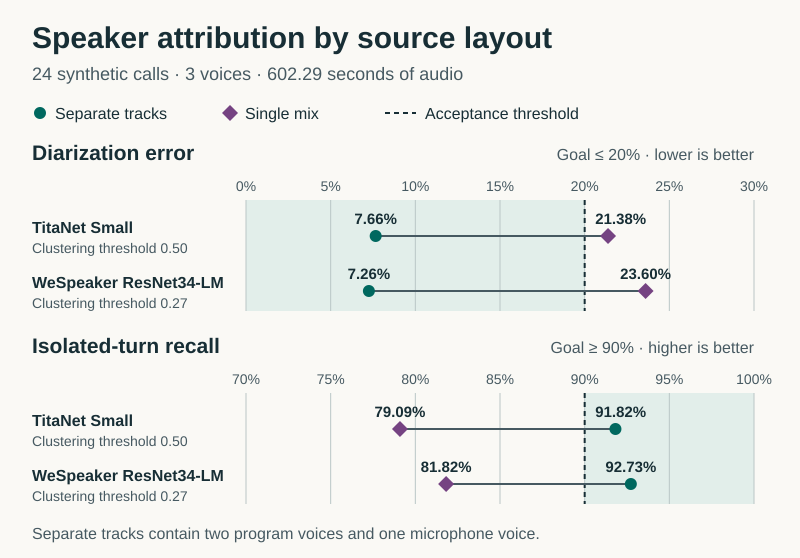
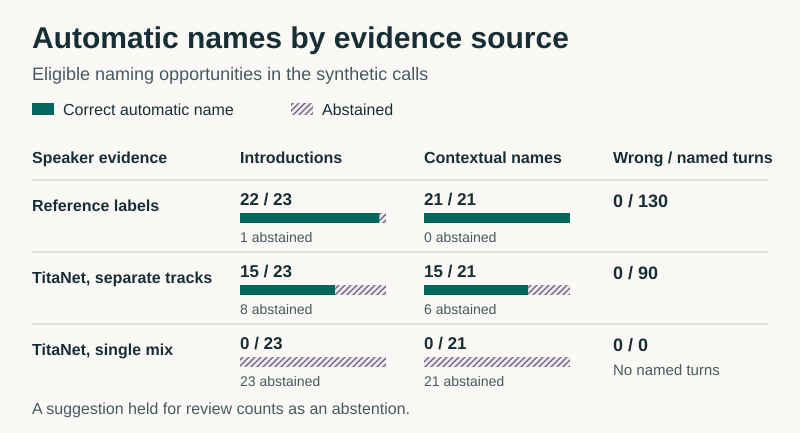
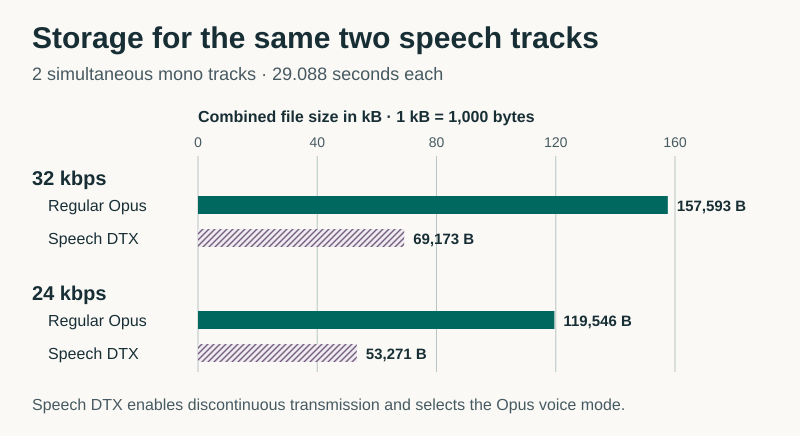
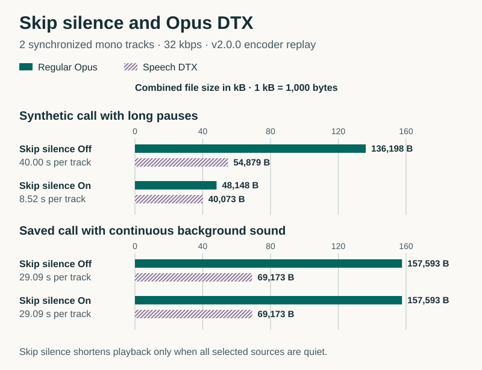
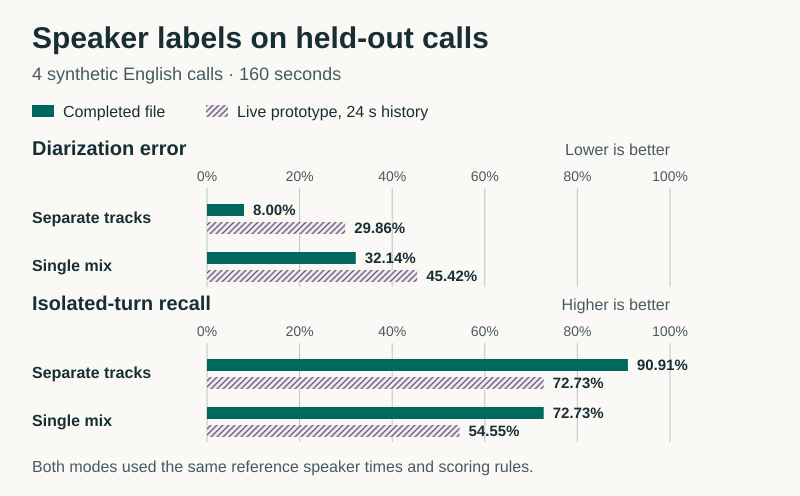
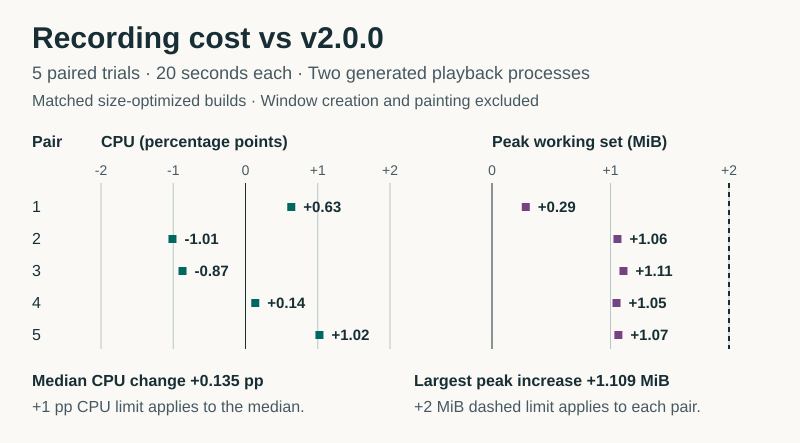

# Benchmark figures

The speaker figures cover synthetic English conversations with supplied words and timestamps. The storage figures describe encoder replays on synthetic and saved tracks. [Aggregate inputs](data.json) · [Performance measurements](../performance.md)

## Speaker attribution



| Embedding model | Clustering threshold | Sources | Diarization error | Isolated turns recovered | Recall |
| --- | ---: | --- | ---: | ---: | ---: |
| NeMo TitaNet Small | 0.50 | Separate tracks | 7.66% | 202 / 220 | 91.82% |
| NeMo TitaNet Small | 0.50 | Single mix | 21.38% | 174 / 220 | 79.09% |
| WeSpeaker ResNet34-LM | 0.27 | Separate tracks | 7.26% | 204 / 220 | 92.73% |
| WeSpeaker ResNet34-LM | 0.27 | Single mix | 23.60% | 180 / 220 | 81.82% |

The test used 24 calls, three Windows voices, ten script sequences, and 602.29 seconds of audio. Twelve cases included overlapping speech. Separate tracks placed two voices on the program track and one on the microphone track. The mix contained all three voices.

Both models used sherpa-onnx 2.0.3 and Pyannote 3.0 segmentation. The scorer matched acoustic clusters to reference speakers separately for each call. It summed the missed, false, and confused speaker durations across calls, then divided by the scored reference speaker duration. The scorer included overlap and excluded 125 milliseconds on each side of every reference boundary. The pooled reference speaker duration was 404,542 milliseconds.

An isolated reference turn lasted at least one second. Recovery required the correct speaker label for at least half the turn. Dashed lines show the acceptance thresholds. Diarization error must be at most 20%. Isolated-turn recall must be at least 90%. The recall axis starts at 70%.

The worker received fixed recognition text and reference timing. Many overlapping voices came from different tracks. Accuracy with natural conversations, live recognition, or simultaneous speakers on one program track remains unverified. [Fixture and scorer](../../rust/tools/test_speaker_acceptance.py) · [Fixture commands](../wiki/verification.md#check-the-speaker-workflow)

## Automatic names



| Speaker evidence | Introductions correct / eligible | Abstained | Contextual names correct / eligible | Abstained | Incorrect / named turns |
| --- | ---: | ---: | ---: | ---: | ---: |
| Reference speaker labels | 22 / 23 | 1 | 21 / 21 | 0 | 0 / 130 |
| TitaNet, separate tracks | 15 / 23 | 8 | 15 / 21 | 6 | 0 / 90 |
| TitaNet, single mix | 0 / 23 | 23 | 0 / 21 | 21 | 0 / 0 |

An eligible introduction names the speaker directly. An eligible contextual name has supporting evidence from a conversation. The first two ratios count naming opportunities. The final ratio counts timed turns displaying automatic names. One inferred name can appear on several turns.

The reference run supplied the true speaker labels. Both reference layouts returned the same counts, so the figure shows one reference row. The same 24 calls included 48 misleading utterance instances and four additional conflict scenarios. The worker held local single-mix suggestions for review. Zero named turns leaves the incorrect-name rate undefined.

These fixed-script results include naming rules revised after failures on the corpus. No run automatically confirmed a cross-session identity. Naming precision on unrelated human conversations remains unverified. [Naming measurements](../performance.md#automatic-names)

## Opus storage



| Target bitrate | Regular Opus, both tracks | Speech DTX, both tracks | Size reduction with Speech DTX |
| --- | ---: | ---: | ---: |
| 32 kbps | 157,593 bytes | 69,173 bytes | 56.1% |
| 24 kbps | 119,546 bytes | 53,271 bytes | 55.4% |

Each setting encoded the same decoded samples from two simultaneous 29.088-second mono tracks. Each output retained all 1,396,203 samples per track at 48 kHz. The axis uses decimal kilobytes. Each bar displays its exact size in bytes. Each reduction compares the two encodings at the same target bitrate.

The original tracks already used Opus. Speech DTX enabled discontinuous transmission and changed the Opus application to VoIP. These measurements include both changes. Regular 32 kbps gave the closest overall match to the original files’ recognition output on this pair. No independent reference transcript was available. [Codec comparison and recognition settings](../performance.md#size-and-speech-recognition)

## Silence removal and Opus DTX



| Track pair | Skip silence | Saved frames per track | Playback per track | Regular Opus | Speech DTX |
| --- | --- | ---: | ---: | ---: | ---: |
| Synthetic call with long pauses | Off | 1,920,000 | 40.00 s | 136,198 B | 54,879 B |
| Synthetic call with long pauses | On | 408,960 | 8.52 s | 48,148 B | 40,073 B |
| Saved call with continuous background sound | Off | 1,396,203 | 29.09 s | 157,593 B | 69,173 B |
| Saved call with continuous background sound | On | 1,396,203 | 29.09 s | 157,593 B | 69,173 B |

Both replays used the v2.0.0 Opus writer at 32 kbps mono. Each pair supplied the same source samples to all four setting combinations. The replay applied the recorder's shared silence threshold and checked the decoded sample counts with FFmpeg. A retained 10 ms block could contain sound in either track.

Skip silence removed 78.7% of the synthetic call's samples. Background sound kept every block of the saved call. Speech DTX reduced the saved call's file size by 56.1% and preserved its duration. The two examples show why savings depend on the signal. This comparison measured recorded audio only. [Aggregate inputs and receipt hashes](data.json)

## Live speaker labels



| Source layout | Completed-file error | Live-prototype error | Completed-file isolated turns recovered | Live-prototype isolated turns recovered |
| --- | ---: | ---: | ---: | ---: |
| Separate tracks | 8.00% | 29.86% | 10 / 11 | 8 / 11 |
| Single mix | 32.14% | 45.42% | 8 / 11 | 6 / 11 |

This trial used four 40-second held-out calls with three synthetic voices and 24 annotated turns. The released adapter read each complete file. The live prototype received four-second blocks and could revise its most recent 24 seconds. Both used the same segmentation and TitaNet Small models.

The trial pooled speaker time across calls. The live prototype missed the separate-track accuracy targets of at most 20% error and at least 90% isolated-turn recall. This figure describes that prototype on this test set. Recognition errors and annotated human calls were outside this trial. [Live speech qualification](live-quality.md) · [Aggregate inputs and receipt hashes](data.json)

## Recording cost



Both builds used the same size-optimized compiler flags. Each trial captured two generated Windows playback processes through WASAPI and saved two 32 kbps mono Opus tracks. The example used the recorder API without creating or painting a window.

Each mark subtracts the v2.0.0 result from the candidate result for that pair. CPU uses percentage points of one logical core. The CPU limit applies to the median of the paired differences. The peak working-set limit applies to each pair. [Recording test methods and results](live-performance.md#selected-process-recording-results) · [Paired measurements](live-performance.json)

## Reproduce the figures

Run these commands from the repository root with Python 3.9 or later. The generator uses only Python's standard library and writes deterministic UTF-8 SVG files.

```console
python docs/benchmarks/generate.py
python docs/benchmarks/generate.py --check
```

The check validates measurement ranges and count totals. It compares each generated figure with its checked-in bytes. It runs without audio, models, or network access.

The aggregate inputs contain pooled speaker durations, naming counts, paired encoded byte counts, and source hashes. The recording inputs contain the paired CPU and memory samples. The generator calculates the chart differences from those samples. [Aggregate inputs](data.json) · [Recording inputs](live-performance.json) · [Generator](generate.py)

When embedding a figure elsewhere, use its image description above. Keep a link to the adjacent table for exact values and scope.
