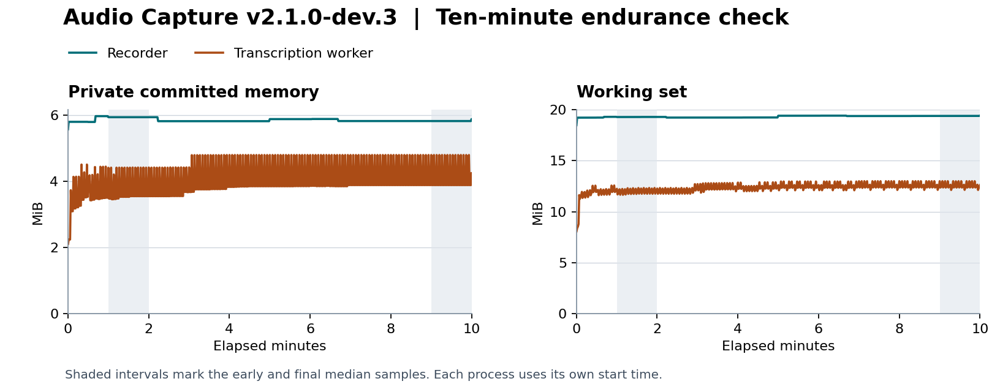

# Independent capture and transcription measurement

The reference PC runs Windows 11 Pro build 26200 on a Ryzen 7 7800X3D with 32 GiB of RAM. It uses the Windows Balanced power plan. The operating system and test data use a Samsung 970 EVO 500 GB NVMe drive. Both builds use rustc 1.99.0, the x64 MSVC target and the static CRT.

## Ten-minute Windows release check

The 2.1.0 promotion check used the published Windows v2.1.0-dev.3 ZIP. The recorder and worker ran in separate processes with independent inputs. Both used the same runtime code as 2.1.0.

| Process | Private memory, minute 2 | Private memory, minute 10 | Change | Frame result |
| --- | ---: | ---: | ---: | --- |
| Recorder | 5.95 MiB | 5.83 MiB | −0.12 MiB | 28,849,038 frames in the finalized silent Opus stream |
| Transcription worker | 3.55 MiB | 3.89 MiB | +0.34 MiB | All 57,600,000 input frames accounted for, with zero gaps or duplicate chunks |

Memory values are medians of one-second samples from 60–120 and 540–600 seconds, excluding each upper bound. The ten-minute promotion limit was 8 MiB of private memory growth per process.



The recorder captured only a test process that produced no sound. It saved 601.02 seconds at 48 kHz in mono. All 604 Ogg pages passed checksum and continuity checks. During recording, the source diagnostics reported zero drops or gaps. No physical microphone or rendered input packets were tested.

The test harness also waited for a timeline file that this recording-only mode does not write. The final Opus file decoded to exactly 28,849,038 silent samples. Final GUI shutdown status was not checked.

The worker received two paced 48 kHz sources through its normal input pipe. A local mock recognition service returned 300 results. Each result appeared once in the final transcript.

The release decision used these ten-minute checks and Windows CI. The two-hour endurance target remains open. [Memory samples](endurance-2.1.0.csv) · [Prerelease tested](https://github.com/scubamount/AudioCapture/releases/tag/v2.1.0-dev.3)

## Reproduce the recording comparison

Build the same `live_perf_capture` example against the v2.0.0 tag and the implementation under test. Copy the example into the baseline's `rust/examples` directory before building. Build the two revisions in different directories. Save each resulting executable under a separate name.

```powershell
Set-Location rust
cargo build --locked --offline --release --example live_perf_capture
python tools/test_live_performance.py capture --baseline .\baseline-live-perf.exe --candidate .\target\x86_64-pc-windows-msvc\release\examples\live_perf_capture.exe --pairs 5 --seconds 20 --output .\capture-results
```

The driver needs Python with psutil, FFmpeg and a working Windows playback endpoint. It plays two quiet, generated signals in dedicated processes. The example records just those two PIDs. Its Opus profile uses 32 kbps mono and separate files, with silence removal off. Each eight-second fixture has speech-like bursts of a square wave, overlap and digital silence. It contains no human speech.

The program and simulated microphone fixture WAV SHA-256 values are `028a1fbc65b6d74d730f408502a2ee487f37b518e15f801dc45ca96e483b0870` and `dec3dc3aa122bf320b3ee058e8b027f863c6a2ef593378ccf534ab35fc178b05`. Each source plays for three seconds per cycle. Two seconds overlap. The test decodes the first complete cycle of each output. It checks that the assigned tone has at least twice the amplitude of the other tone. Windows supplies the live timestamps. Runs can differ slightly in duration.

Each pair reverses the preceding execution order. The driver records per-process CPU time, the Windows peak working set, private bytes, child process samples, output durations, and file sizes. CPU percentage uses one logical core as 100%. Peak working set includes process startup. External process polling cannot rule out short-lived child processes.

### Selected process recording results

The baseline used v2.0.0 commit `d96b4421` and its original release profile. The candidate used the 750 KiB two-output writer queue. It used `opt-level = "s"`, fat LTO, one code generation unit and unwind. Each recorder wrote two 32 kbps mono Opus files for 20 seconds. Other development activity and endurance captures ran on this shared PC.

| Pair | v2.0.0 CPU, % of one core | Candidate CPU, % of one core | v2.0.0 peak working set, MiB | Candidate peak working set, MiB |
| --- | ---: | ---: | ---: | ---: |
| 1 | 1.34 | 1.41 | 11.98 | 12.91 |
| 2 | 1.34 | 1.80 | 12.08 | 12.80 |
| 3 | 1.02 | 1.88 | 12.15 | 12.89 |
| 4 | 1.95 | 1.42 | 12.00 | 12.98 |
| 5 | 1.10 | 1.87 | 12.14 | 13.01 |
| Median | 1.34 | 1.80 | 12.08 | 12.91 |
| p95, nearest rank | 1.95 | 1.88 | 12.15 | 13.01 |

The median paired CPU increase was 0.465 percentage points. The p95 increase was 0.861 points. The largest paired peak working-set increase was 0.977 MiB. All 20 files contained their assigned tone. The lowest measured amplitude ratio between assigned and other tones was 51.8.

The benchmark executable SHA-256 values are `eabe7957818f555d576666a9c322563d42e02ab3ce106b99bf71ddae4e8bf836` for v2.0.0 and `fcfe4cb736b538ef55a09914a898097485aa37c72f93a0b15d31feddecd9cf50` for the candidate. These executables open the recorder session through the same API as the GUI. They omit window creation and painting.

The second comparison used the same size profile for both builds. The v2.0.0 executable SHA-256 was `5e63b720128801250fe703f8a94fc2fadeb0767e8c9cc6a4b79a554c875d9a2d`. The candidate executable was identical to the first comparison.

| Pair | v2.0.0 size profile CPU, % of one core | Candidate size profile CPU | v2.0.0 peak working set, MiB | Candidate peak working set, MiB |
| --- | ---: | ---: | ---: | ---: |
| 1 | 1.88 | 2.51 | 12.72 | 13.00 |
| 2 | 2.03 | 1.02 | 11.97 | 13.03 |
| 3 | 2.28 | 1.41 | 11.87 | 12.98 |
| 4 | 2.05 | 2.19 | 11.87 | 12.92 |
| 5 | 1.26 | 2.28 | 11.98 | 13.05 |
| Median | 2.03 | 2.19 | 11.97 | 13.00 |
| p95, nearest rank | 2.28 | 2.51 | 12.72 | 13.05 |

With matched flags, the median paired CPU increase was 0.135 points. The p95 paired CPU increase was 1.023 points. The largest paired peak working-set increase was 1.109 MiB. The CPU acceptance limit applies to the median paired increase.

A separate five-second recording check traced WinHTTP and Winsock AFD for the candidate PID. It reported zero target events and zero lost events. Loopback controls produced 17 WinHTTP and 61 AFD events. Fifty process samples observed no recognizer child, model module or socket. The only observed child was the Windows console host.

### Native window checks

Five separate pairs exercised the actual recorder window on private Windows desktops. Both v2.0.0 and the package candidate used the size profile. Each app selected one generated 600 Hz process and wrote regular 32 kbps mono Opus. The test decoded every output and verified the assigned tone. Each app used a fresh profile. The window measured 900 by 700 physical pixels.

| Pair | v2.0.0 CPU, % of one core, 20 s | Candidate CPU, 20 s | v2.0.0 lifetime peak working set, MiB | Candidate lifetime peak working set, MiB |
| --- | ---: | ---: | ---: | ---: |
| 1 | 1.325 | 2.572 | 18.219 | 19.473 |
| 2 | 2.026 | 2.416 | 17.398 | 19.590 |
| 3 | 0.934 | 3.508 | 17.387 | 19.305 |
| 4 | 1.556 | 1.871 | 17.395 | 19.363 |
| 5 | 1.789 | 2.102 | 17.344 | 19.398 |

The median 20-second CPU measurements were 1.556% for v2.0.0 and 2.416% for the candidate. The median paired increase was 0.389 percentage points. The first ten seconds added a median 1.410 points. The second ten seconds decreased by a median 0.157 points. The process CPU measurements exclude the fixture player.

**The package candidate missed the native-window peak working-set target in two pairs.** Its largest increase was 2.191 MiB against a 2 MiB limit. The largest increase in working set sampled during steady recording was 1.605 MiB. The native package recorder SHA-256 was `96b6a9c65825006e2f1ac494ce110c6c726c739dee7b142ceb8a43935ba38fbe`.

Fresh v2.0.0 and candidate native windows used 0.00 measured CPU seconds at idle over ten seconds each. These checks used fresh profiles on separate Windows desktops. The candidate also used 0.00 CPU seconds during a ten-second check with a completed transcript preview.

An earlier visible-window sample used 22.6% of one core while stopped and 37.5% while recording one synthetic process. The stopped sample on the same window later returned to 0.00 CPU seconds. These short observations do not establish a steady-state rate. All 200 thread-stack samples from the later idle check showed the window thread waiting for a message.

A different test held a loopback transcription request for at least 2.234 seconds while a batch waited. It sent 24 native Pause or Resume commands during recording. The median time to observe the control caption was 0.555 ms. The p95 was 1.524 ms, and the maximum was 1.982 ms. The recorded timeline contained all 12 pauses. This measures the acknowledgement visible to Win32 controls. It excludes a physical mouse and screen refresh.

### Capture relay under load

A separate instrumented build counted allocations on the thread that supplied PCM to the real relay. A second process read its normal framed pipe. One atomic counter measured queue occupancy. The allocation counter excludes the reader, encoder, and Windows internals.

| Two-source input | Real time | Deliberate overload |
| --- | ---: | ---: |
| Enqueue calls | 2,400 | 200,000 |
| Allocations on the supplying thread after startup | 0 | 0 |
| Maximum outstanding audio packets, 512 available | 2 | 512 |
| Input source frames | 1,152,000 | 96,000,000 |
| Frames received by the reader | 1,152,000 | 1,232,160 |
| Frames the relay explicitly marked missing | 0 | 94,767,840 |

The supplying thread allocated 2,474,023 bytes when it created the relay. Real-time blocks arrived every 10 ms. Their p95 enqueue time was 10.3 μs. During overload, most calls returned immediately after detecting the full queue.

## Reproduce the worker comparison

```powershell
python tools/test_live_performance.py worker --worker .\package\transcribe.exe --seconds 60 --delay 0.45 --output .\worker-results
```

The worker receives two synthetic PCM16 sources at 48 kHz through its normal live pipe. A local multipart endpoint returns a unique token for each submitted frame range. It verifies the embedded source ID and start time before replying. A reader observes tokens in the ordinary UTF-8 transcript. This measures request scheduling, transfer, durable output, and publication. Recognition quality uses a separate test.

### Integrated worker result

The 60-second test used a 450 ms delay per endpoint reply. The slowest response took 468 ms. Both generated sources were active for the full interval. Twenty-eight chunks ended at or after eight seconds and qualified for the latency calculation.

| Measurement | Result |
| --- | ---: |
| Expected and received source frames | 5,760,000 |
| Replies present once in the final text | 30 of 30 |
| Missing frames or replies | 0 |
| Eligible chunk end to readable text, p95 | 1.573 s |
| Local reply to readable text, p95 | 0.145 s |
| Local reply to readable text, maximum | 0.193 s |
| Stop to worker exit | 1.882 s |
| Working set, Windows process peak | 12.07 MiB |

The worker SHA-256 was `bdc64cbd173307e7736d4d4102b6351a192ab5f2003197a3d6d5e1afdc07ba0b`. The test read the partial text every 50 ms. The visibility measurements include this sampling interval. The measurements exclude ASR model compute and optional local speaker analysis. Other builds and fixture captures ran on the same PC.

The size-profile package worker repeated all 30 replies with zero missing frames. Its p95 eligible end to readable text was 1.023 s. Its p95 reply to readable text was 0.077 s. Its largest observed reply to readable delay was 0.091 s. The largest measured endpoint delay was 0.463 s. Input and finalization together reached 4.82 MiB peak private commit and 12.19 MiB peak working set. The executable SHA-256 was `785d814f77337f7a2811f2a37ccf92b87a723f5e401fff8f0b1f216d4a40aee3`.

### Maximum source count under pressure

```powershell
python tools/test_live_performance.py worker --worker .\package\transcribe.exe --seconds 24 --delay 1 --pressure --output .\pressure-results
```

This test sends 16 continuous sources to one worker for 24 wall-clock seconds. The endpoint waits one second for each request. At this rate, it falls behind input. The final TXT contained all 28 responses exactly once. The journal covered all 18,432,000 source frames. Recognition covered 5,376,000 frames. Explicit gaps covered the other 13,056,000 frames. The worker marked the output incomplete.

Windows reported 18.29 MiB peak private commit and 24.67 MiB peak working set during input. These totals include the executable’s ordinary runtime allocations. The temporary directory had zero bytes at each one-second sample. Temporary storage between samples was not checked.

The size-profile package worker produced the same frame totals and explicit gaps. Input and finalization together reached 17.74 MiB peak private commit and 24.59 MiB peak working set.

Run either command with `--seconds 7205` for a wall-clock endurance test. Set `--pairs 1` for a single recorder endurance run. Use the default worker speed of 1. The report compares median private bytes near minutes 30 and 120. A faster source clock exercises throughput and cannot establish two-hour wall-clock stability.

The acceptance criteria and reference methodology are in the [live acceptance plan](../../openspec/changes/add-independent-live-transcription/acceptance.md).

The [machine-readable measurement data](live-performance.json) include each paired run, hashes, working-set values in bytes, and the generated worker results.
