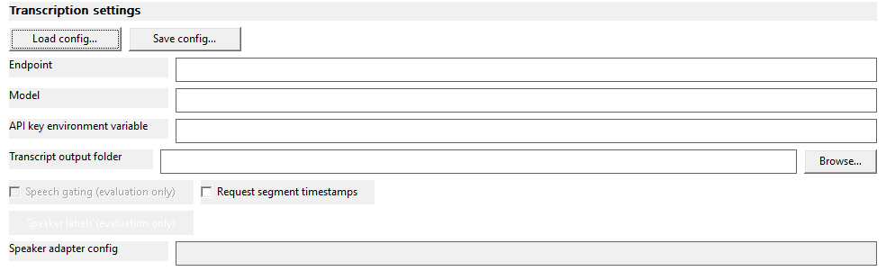

# Live transcription

Use separate controls to keep a recording, a live transcript, or both. Live transcription sends approved audio to the endpoint you configure. For offline recognition, use the local workflow on a finished English MP4. [Operator guide](../rust/README.md) · [Offline MP4 setup](../rust/README.md#transcribe-an-mp4-offline)

## Choose the sources

1. Open the program or join the call.
2. Select the program that carries the sound.
3. Select a microphone if you want your side of the conversation.
4. Check the source list.
5. Open **Recording settings**. Choose your profile, recording mode, and output folder.

Choose these recording settings before starting either activity. They stay fixed for the active capture session, even if you start with transcription alone.

Open **Recording settings** or **Transcription settings** during a call to inspect the active values. Opening or closing either panel keeps both activities running.

Choose a program in **Recent programs** and select **Use recent**. **Auto-select recent** in **Manage recent** can select a verified returning program. Check the sources before you start. If a program update or restart leaves the match uncertain, refresh and choose the intended process.

## Choose the endpoint

Use a service that accepts multipart WAV uploads at `<base-url>/audio/transcriptions`. Open **Transcription settings** and enter the base URL and model. Use HTTPS for a remote endpoint. Use a loopback address for a local service. If the service requires a bearer token, enter the name of its environment variable. [Set a bearer token](../rust/README.md#set-a-bearer-token-for-the-session)

Select **Load config…** to fill the transcription settings from a JSON file. Use **Save config…** to export the current fields. For a fresh extraction, put your `transcription.json` beside `audio-capture.exe` to load it at startup.

The ZIP contains an example at `config/transcription.example.json`. Relative paths use the config file's folder. The config stores the API key variable name. Keep the key value in the environment. [Config fields and validation](../rust/README.md#load-a-transcription-config)

Set **Transcript output folder** to store the result separately from audio. An empty value uses the recording output folder.

Select **Request segment timestamps** if the chosen service and model return timed segments. The worker can keep the text when usable segment timing is unavailable.

Select **Start transcription**. Review the sources, endpoint, model, and output folder. Approve this interval to begin. A new live interval asks for approval again.

## Control both outputs

| Action | Result |
| --- | --- |
| **Start recording** | Opens an audio output interval. |
| **Start transcription** | Opens a live text interval after approval and admission. |
| **Stop recording** | Finalizes the audio. An active transcript continues. |
| **Stop transcription** | Stops taking new audio for text. The worker saves accepted results. Recording can continue. |
| **Stop both** | Ends both active intervals at the same source position. Each output finalizes independently. |



The live status shows when the admission slot is available. A waiting request starts no transcript coverage. Select **Cancel transcription start** if you no longer want to wait. The selected sources stay fixed while capture is active. End the active intervals before you change the source scope.

Text-only mode keeps the transcript and its coverage information. Temporary speech samples stay in bounded worker memory. Start recording to keep playable audio. Recording begins at its own start time.

## Find the text

During the call, **Open transcript** opens the worker's readable UTF-8 partial text. The preview shows recent results. When you stop transcription, wait for the final path. The worker publishes `Transcript-<interval>.txt` and `Transcript-<interval>.segments.jsonl` in the selected output folder.

Use the source labels to distinguish program audio and microphone audio. Read a range as a source-time position. A label such as Discord identifies an audio source. Several people can speak through that source.

The result reports incomplete ranges when the service times out or the worker misses input. After **Stop transcription**, select **Cancel pending requests** to finish with available text. If a result might have completed remotely, the worker preserves that state for review.

### Recover a stopped or interrupted transcript

Run these commands in PowerShell from the extracted package. Replace `INTERVAL` with an ID from the list. Use a new output folder when the original folder is unavailable.

```powershell
.\transcribe.exe recover-live list
.\transcribe.exe recover-live publish INTERVAL --output-dir '.\recovered'
```

Recovery uses the saved local text. It can identify ranges without a committed result. If you choose to discard a recovery entry, run `recover-live discard INTERVAL --confirm`.

## Reduce recording size

| Option | Effect |
| --- | --- |
| **Skip silence** | Removes shared quiet blocks from the saved recording. |
| **Speech DTX** | Uses fewer Opus bytes during quiet periods while retaining elapsed time when recording silence removal is off. |
| Recognition speech gating | Can omit quiet input before recognition. The prerecorded quality checks determine whether a profile qualifies for normal use. |

The transcript uses the source clock. The recording uses the clock after pause and silence removal. If a word falls inside a removed recording range, it can still appear in live text. That word has no saved playback position. Use the recording's timeline metadata to locate text that has retained audio. [Time mapping requirements](../openspec/changes/add-independent-live-transcription/specs/silence-and-time-mapping/spec.md)

The recording writes a timeline when it overlaps a live transcript. If recording starts first, the map begins when the activities first overlap. The saved audio can contain earlier material.

See the byte and duration results from paired runs with regular Opus, speech DTX, and recording silence removal. [Storage comparison](benchmarks/README.md#silence-removal-and-opus-dtx)

## Use finished files or refine speakers

Select **Transcribe files…**. Use **Use an endpoint…** to submit finished files to the service from **Transcription settings**. Check the inputs and destination before you approve. With the default request limit, an active live transcript defers a pending batch against the same endpoint. [Endpoint batch commands](../rust/README.md#use-an-endpoint-for-completed-files)

To pair an endpoint batch with a local speaker session, run the following command. Check the files and manifest in the preview before you approve.

```powershell
.\transcribe.exe batch-queue submit --attribute-session '.\offline-session.json' -- '.\Discord.opus' '.\Microphone.opus'
```

Use **Separate files** when you plan to run offline speaker analysis. Select the saved audio and its recognition results for the local adapter. Check speaker assignments and evidence before approving a memory export. [Offline speaker workflow](speaker-workflow.md)

The standard UI marks live speaker labels and recognition speech gating as **evaluation only**. Use the offline speaker workflow for reviewed labels and names. [Qualification results](benchmarks/live-quality.md) · [Acceptance plan](../openspec/changes/add-independent-live-transcription/acceptance.md)

### Bring a live transcript into speaker review

Use the final `.segments.jsonl` to create a review session. Keep the TXT and index with your call files. Run these commands from the extracted folder. Replace the input paths with your files.

```powershell
.\transcribe.exe refine-live --index '.\Transcript-CALL.segments.jsonl' --session '.\call-session.json'
.\transcribe.exe review-session --session '.\call-session.json'
```

To refine speaker labels locally, add the recording timeline, one saved source track, and a trusted offline adapter configuration. The same session can accept refinement for another saved track. Live words and coverage remain in the review session. Refinement can cover only ranges with matching audio.

```powershell
.\transcribe.exe refine-live --index '.\Transcript-CALL.segments.jsonl' --session '.\call-session.json' --timeline '.\Recording-CALL.timeline.jsonl' --audio '.\Discord.opus' --adapter-config '.\adapter.json'
```

Review the latest session revision before you approve memory export. [Local adapter and export procedure](speaker-workflow.md)
